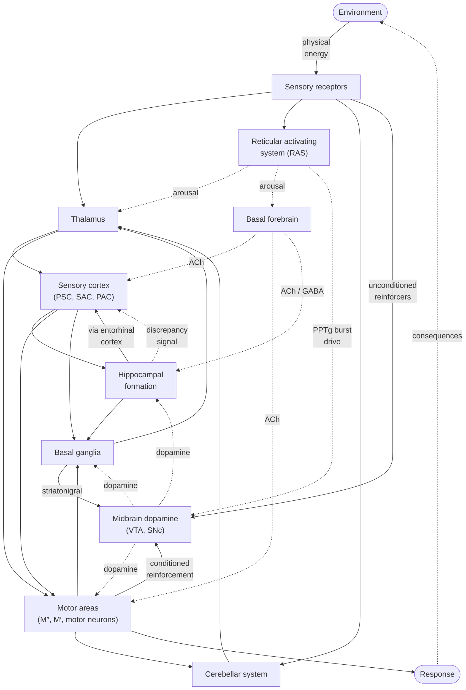
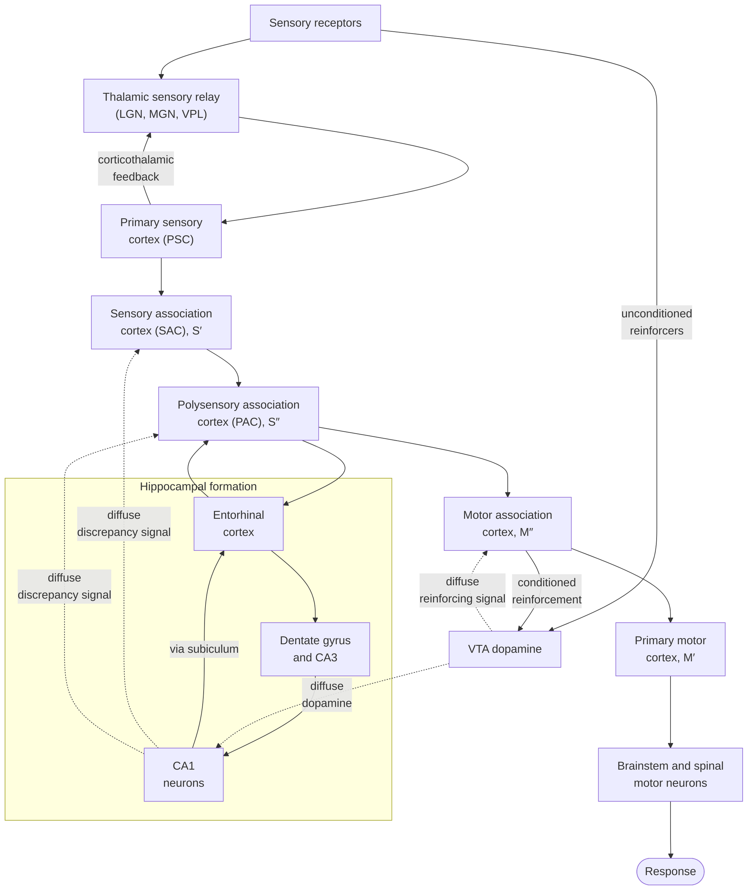
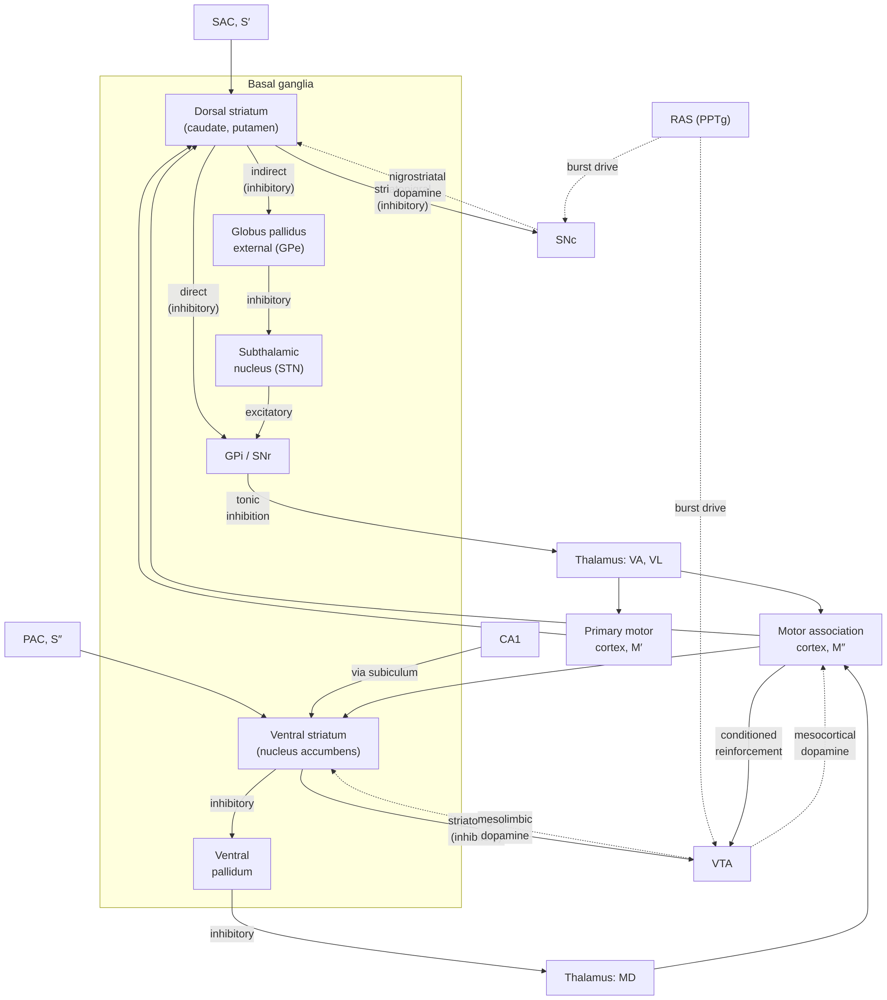
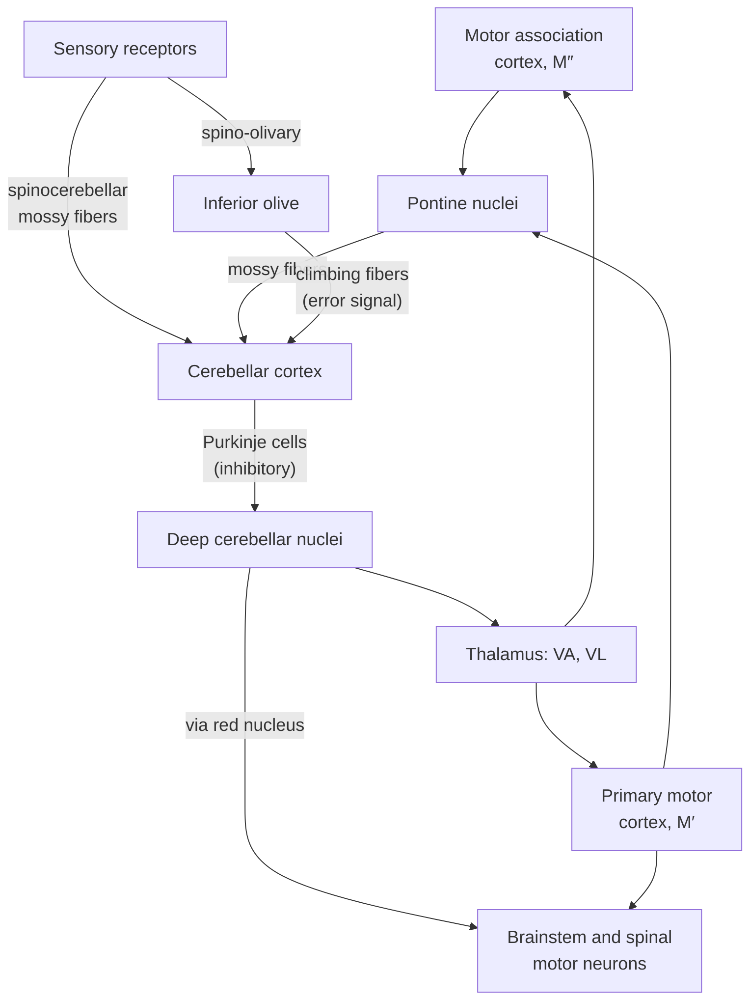
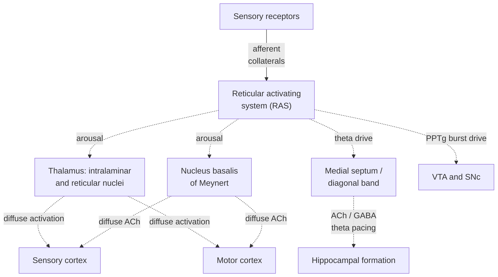

# Neural Architecture Reference: Sensory, Hippocampal, Motor, and Neuromodulatory Systems

## LLM Generated

I have scanned, but not thoroughly checked, the diagram, tables, and prompt. This is intended as a working diagram to provide some context. It will change as I come to understand more.

For instructions on how to modify and regenerate the diagram in [Claude.ai](https://claude.ai/), see [neural_architecture_prompt.md](./neural_architecture_prompt.md).

## Reference

Layer labels S′, S″, M″, and M′ follow [Donahoe, Burgos & Palmer (1993)](../../References.md#donahoe-burgos-palmer-1993).

## Diagrams

Solid arrows show specific, topographic pathways that carry stimulus or response information. Dashed arrows show diffuse projections that change how active or how plastic the target is.

The architecture is drawn as one overview and four focused diagrams, each laid out top to bottom. Each diagram is set to render at full size (`useMaxWidth: false`) instead of shrinking to fit the page; wide diagrams scroll sideways rather than shrink.

### 1. Overview

### 2. Sensory–hippocampal–motor pathway (selection-network core)

### 3. Basal ganglia and midbrain dopamine

### 4. Cerebellar system

### 5. Arousal and cholinergic modulation

## Components and Flows

| Component | Description | Flows |
|---|---|---|
| **Environment** | The physical surroundings of the organism. It provides stimuli and receives the consequences of responses. | Supplies physical energy (light, sound, pressure, chemicals) to receptors. Receives the effects of responses, closing the behavior–environment loop through which consequences select behavior. |
| **Sensory receptors** | Specialized cells that convert physical energy into neural signals: photoreceptors, hair cells, mechanoreceptors, chemoreceptors. | Send afferents to the thalamic sensory relay nuclei. Collaterals reach the RAS. Spinocerebellar fibers carry body-state information to the cerebellar cortex, and spino-olivary fibers reach the inferior olive. Signals from unconditioned reinforcers reach the VTA through intermediate nuclei such as the lateral hypothalamus and PPTg. |
| **Thalamus: sensory relay nuclei** | Modality-specific nuclei: lateral geniculate (vision), medial geniculate (audition), and ventral posterolateral (somatosensation). Olfaction largely bypasses the thalamus. | Receive receptor afferents and send topographic projections to primary sensory cortex. Receive corticothalamic feedback from primary sensory cortex, which shapes relay gain. |
| **Thalamus: motor relay nuclei (VA, VL)** | Ventral anterior and ventral lateral nuclei. They join the basal ganglia and cerebellar loops to motor cortex. | Receive tonic inhibition from GPi/SNr and excitation from the deep cerebellar nuclei. Project to motor association cortex and primary motor cortex. |
| **Thalamus: mediodorsal nucleus (MD)** | Association nucleus closely tied to prefrontal cortex. It relays the ventral basal ganglia loop. | Receives inhibitory input from the ventral pallidum. Projects to motor association (prefrontal) cortex. |
| **Thalamus: intralaminar and reticular nuclei** | Intralaminar nuclei project widely to cortex and striatum. The thalamic reticular nucleus is a GABAergic shell that gates thalamocortical transmission. | Receive arousal input from the RAS. Send diffuse activation to sensory and motor cortex and set overall cortical excitability and attention-related gating. |
| **Primary sensory cortex (PSC)** | V1, A1, S1, and their equivalents. Neurons respond to elementary stimulus features and are arranged in topographic maps. | Receives thalamic sensory relay input. Projects to sensory association cortex and sends corticothalamic feedback to the relay nuclei. |
| **Sensory association cortex (SAC), S′** | Unimodal association areas that combine elementary features into complex stimulus configurations within a single modality. In the selection network these are the S′ units. | Receives input from primary sensory cortex. Projects to polysensory association cortex and dorsal striatum. Receives the diffuse CA1 discrepancy signal, which makes its connection weights changeable. |
| **Polysensory association cortex (PAC), S″** | Multimodal regions (for example the superior temporal sulcus and posterior parietal cortex) that combine input across modalities. In the selection network these are the S″ units. | Receives input from sensory association cortex and entorhinal return projections. Projects to entorhinal cortex, motor association cortex, and ventral striatum. Receives the diffuse CA1 discrepancy signal. |
| **Entorhinal cortex** | The main gateway between neocortex and hippocampus. Its superficial layers project into the hippocampus, and its deep layers return hippocampal output to cortex. | Receives polysensory association input. Sends the perforant path to dentate gyrus and CA3, plus a direct (temporoammonic) path to CA1. Receives CA1 output through the subiculum and projects back to polysensory association cortex. |
| **Dentate gyrus and CA3** | Dentate granule cells separate similar input patterns. CA3 pyramidal cells, with their recurrent collaterals, support pattern completion. | Dentate gyrus receives perforant-path input and sends mossy fibers to CA3. CA3 projects to CA1 through the Schaffer collaterals. |
| **CA1 neurons** | Hippocampal output pyramidal cells. They compare the CA3 input with the direct entorhinal input. In the selection network, CA1 activity is a diffuse discrepancy signal that enables learning in sensory association layers. | Receive Schaffer-collateral and entorhinal input, plus diffuse VTA dopamine. Project through the subiculum to entorhinal cortex and ventral striatum. In the model, a diffuse discrepancy signal goes to sensory association (S′) and polysensory association (S″) cortex. |
| **Motor association cortex, M″** | Premotor, supplementary motor, and prefrontal regions that organize response sequences. In the selection network these are the M″ units, the main target of the dopamine reinforcing signal. | Receives input from polysensory association cortex, the VA/VL and MD thalamic nuclei, and VTA dopamine. Projects to primary motor cortex, both striatal divisions, the pontine nuclei, and the VTA (the conditioned-reinforcement pathway). |
| **Primary motor cortex, M′** | Precentral gyrus. Its output neurons code movement parameters and project to brainstem and spinal motor neurons. In the selection network these are the M′ units. | Receives input from motor association cortex and the VA/VL thalamic nuclei. Projects to brainstem and spinal motor neurons (corticospinal and corticobulbar tracts), the dorsal striatum, and the pontine nuclei. |
| **Brainstem and spinal motor neurons** | Lower motor neurons that innervate skeletal muscle: the final common path for responses. | Receive input from primary motor cortex and, through the red nucleus, from the deep cerebellar nuclei. Their output produces the response. |
| **Response** | The observable movement emitted by the organism. | Produced by motor neuron output. Acts on the environment and generates consequences, some of which function as reinforcers. |
| **Dorsal striatum** | Caudate and putamen. Medium spiny neurons expressing D1 receptors form the direct pathway, and those expressing D2 receptors form the indirect pathway. It contributes to response selection and habit. | Receives input from sensory association and motor cortex, plus nigrostriatal dopamine from the SNc. Sends direct-pathway output to GPi/SNr, indirect-pathway output to GPe, and inhibitory feedback to the SNc. |
| **Ventral striatum** | The nucleus accumbens. It joins reinforcement-related and contextual input to response selection. | Receives input from polysensory association cortex, the hippocampus (through the subiculum), motor association cortex, and mesolimbic dopamine from the VTA. Sends inhibitory output to the ventral pallidum and inhibitory feedback to the VTA. |
| **Globus pallidus external (GPe)** | GABAergic relay in the indirect pathway. | Receives inhibitory dorsal striatal input and sends inhibitory output to the subthalamic nucleus. |
| **Subthalamic nucleus (STN)** | The only excitatory (glutamatergic) nucleus in the basal ganglia. | Receives inhibitory input from the GPe and sends excitatory output to GPi/SNr, increasing their inhibition of the thalamus. |
| **GPi / SNr** | Globus pallidus internal and substantia nigra pars reticulata, the GABAergic output nuclei of the basal ganglia. Their tonic firing suppresses competing responses. | Receive direct-pathway inhibition and STN excitation. Send tonic inhibition to the VA/VL thalamic nuclei. A pause in their firing disinhibits the selected response. |
| **Ventral pallidum** | The output nucleus of the ventral basal ganglia loop. | Receives inhibitory ventral striatal input and sends inhibitory output to the mediodorsal thalamic nucleus. |
| **Ventral tegmental area (VTA)** | Midbrain dopamine neurons. Phasic bursts follow unpredicted reinforcers and, after conditioning, the stimuli that predict them. In the selection network, VTA output is the diffuse reinforcing signal. | Receives input from unconditioned reinforcers, M″ (the conditioned-reinforcement pathway), PPTg bursts, and inhibitory ventral striatal feedback. Sends mesocortical dopamine to M″, diffuse dopamine to CA1, and mesolimbic dopamine to the ventral striatum. |
| **Substantia nigra pars compacta (SNc)** | Midbrain dopamine neurons next to the VTA. They supply dopamine to the dorsal striatum and modulate response selection and habit learning. | Receives PPTg bursts and inhibitory feedback from the dorsal striatum. Sends nigrostriatal dopamine to the dorsal striatum. |
| **Pontine nuclei** | Relay neurons in the basal pons that carry cortical activity into the cerebellum. | Receive input from motor association and primary motor cortex. Send mossy fibers to the cerebellar cortex. |
| **Cerebellar cortex** | Granule cells, parallel fibers, and Purkinje cells. It learns timed sensorimotor associations, guided by climbing-fiber error signals. | Receives mossy-fiber input from the pontine nuclei and spinocerebellar tracts, plus climbing fibers from the inferior olive. Purkinje cells send inhibitory output to the deep cerebellar nuclei. |
| **Deep cerebellar nuclei** | Dentate, interposed, and fastigial nuclei: the cerebellum's output stage. | Receive Purkinje inhibition and collateral excitation. Project to the VA/VL thalamic nuclei and, through the red nucleus, to brainstem and spinal motor neurons. |
| **Inferior olive** | Medullary nucleus whose climbing fibers carry error or unexpected-event signals to Purkinje cells. | Receives spino-olivary and other afferent input. Sends climbing fibers to the cerebellar cortex, where they drive plasticity at parallel-fiber synapses. |
| **Nucleus basalis of Meynert** | Cholinergic neurons of the basal forebrain. They raise cortical signal-to-noise and make cortical plasticity easier. | Receives arousal input from the RAS. Sends diffuse acetylcholine to sensory and motor cortex. |
| **Medial septum / diagonal band** | Cholinergic and GABAergic basal forebrain neurons that pace hippocampal theta rhythm. | Receives theta drive from the brainstem reticular formation. Sends acetylcholine and GABA projections to the hippocampal formation. |
| **Reticular activating system (RAS)** | Brainstem reticular core, including the cholinergic PPTg and laterodorsal tegmental nuclei. It controls arousal, sleep–wake state, and readiness to respond. | Receives collaterals from sensory afferents. Sends arousal input to the intralaminar and reticular thalamic nuclei and to the nucleus basalis, theta drive to the medial septum, and PPTg burst drive to the VTA and SNc. |

## Reference

Donahoe, J. W., Burgos, J. E., & Palmer, D. C. (1993). A selectionist approach to reinforcement. *Journal of the Experimental Analysis of Behavior, 60*(1), 17–40.
